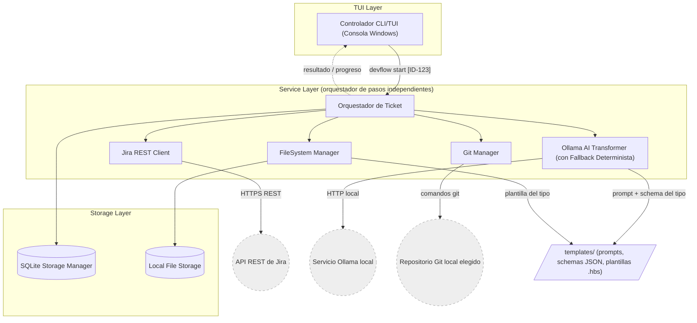
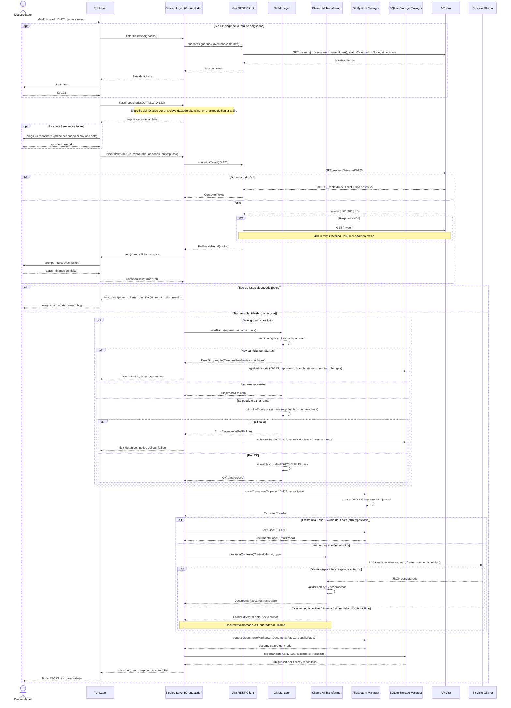

## 2. Arquitectura del Sistema

> Las decisiones de esta sección están respaldadas por el registro formal de decisiones: [`ADR-001-arquitectura-inicial.md`](ADR-001-arquitectura-inicial.md).

### **2.1. Diagrama de arquitectura:**

Patrón adoptado: **3 capas** (ver [ADR-001-arquitectura-inicial.md, §0](ADR-001-arquitectura-inicial.md#0-evaluación-del-patrón-arquitectónico-modular-propuesto-tui-layer--service-layer--storage-layer)):

- **TUI Layer** — interacción con el desarrollador.
- **Service Layer** — orquestador de pasos independientes por integración (no un servicio monolítico), cada uno con resultado `Ok | FallbackManual | FallbackDeterminista | ErrorBloqueante`.
- **Storage Layer** — acceso a SQLite y al sistema de archivos.

**Diagrama de componentes:**



> `ORCH --> SQLITE` es la **única** flecha hacia la Storage Layer: el Orquestador es el único componente que escribe en `ticket_logs`, al finalizar el flujo, con el resultado agregado de todos los pasos. Jira REST Client, Ollama AI Transformer y Git Manager no acceden a SQLite directamente — así el `SQLite Storage Manager` sigue siendo el único punto de acceso a la Storage Layer y ningún componente de integración necesita conocer su esquema.

**Diagrama de secuencia E2E** (`devflow start [ID-123]`):



**Justificación del patrón de 3 capas** (ver [ADR-001-arquitectura-inicial.md](ADR-001-arquitectura-inicial.md)):

El diagrama de secuencia materializa el ajuste exigido en el [§0 del ADR-001](ADR-001-arquitectura-inicial.md#0-evaluación-del-patrón-arquitectónico-modular-propuesto-tui-layer--service-layer--storage-layer): la Service Layer no es un método lineal con un único bloque try/catch, sino un **orquestador de pasos independientes** (Jira, Git, FileSystem, Ollama), donde cada paso devuelve explícitamente `Ok`, `FallbackManual`, `FallbackDeterminista` o `ErrorBloqueante` sin detener el flujo completo ante un fallo aislado. `ErrorBloqueante` cubre los fallos que no tienen un camino de fallback definido (p. ej. repositorio no encontrado, cambios pendientes en el repositorio, fallo del pull de la rama base, permisos insuficientes al escribir en disco): en esos casos el Orquestador detiene el flujo y reporta a la TUI qué pasos sí se completaron, dejando la resolución en manos del desarrollador (ver Git Manager y FileSystem Manager en §2.2). La rama de fallback de Jira corresponde a la clasificación de errores y a la autenticación sin navegador decidida en [ADR-001.1](ADR-001-arquitectura-inicial.md#adr-0011-interfaz-clitui-frente-a-aplicación-gráfica-guiweb); la rama de fallback de Ollama corresponde directamente a [ADR-003.1](ADR-001-arquitectura-inicial.md#adr-0031-llm-local-ollama-con-fallback-determinista-frente-a-apis-cloud-openaianthropic); la persistencia del historial vía `SQLite Storage Manager` corresponde a [ADR-002.1](ADR-001-arquitectura-inicial.md#adr-0021-persistencia-en-sqlite-embebida-frente-a-archivos-planos-jsonyaml); y la escritura de carpetas/documento en disco local corresponde a [ADR-004.1](ADR-001-arquitectura-inicial.md#adr-0041-almacenamiento-local-de-evidencias-en-carpeta-del-ticket-frente-a-sincronización-automática-con-google-drive).

### **2.2. Descripción de componentes principales:**

El PRD (sección "Alcance del MVP") y el ADR-001 definen los siguientes componentes funcionales, agrupados por capa, ya con su decisión tecnológica aprobada. El stack de implementación está aceptado en el ADR-006.1: TypeScript `strict` sobre Node.js ≥ 22.13 (ver §2.3 y `docs/008-evaluacion-stack-tecnologico.md`):

**TUI Layer**

- **Controlador de interfaz de consola (Windows):** único punto de entrada del usuario (`devflow start [ID]`, `devflow config` y comandos relacionados). Se comunica con el Orquestador de forma **asíncrona basada en eventos de progreso** (`onStep(paso, estado)`) y un único callback `ask()` para los datos que solo el usuario puede dar durante el flujo (la carga manual ante un fallo de Jira); la elección del ticket y del repositorio la resuelve **antes** de iniciar el flujo, consultando al Orquestador (`listarTicketsAsignados`, `listarRepositoriosDelTicket`). No usa una única llamada bloqueante — esto le permite renderizar spinners/estado en vivo durante los pasos que pueden tardar (consulta a Jira, procesamiento con Ollama) en vez de quedar "congelada" hasta el resultado final. Renderiza también prompts (incluida la carga manual del fallback de Jira), menús de selección (ticket asignado, repositorio), un spinner simple con el progreso de cada paso —incluido el *streaming* de Ollama— y el resumen final de la ejecución; nunca accede directamente a la Storage Layer ni a servicios externos — todo pasa por el Orquestador de la Service Layer. Decisión: [ADR-001.1](ADR-001-arquitectura-inicial.md#adr-0011-interfaz-clitui-frente-a-aplicación-gráfica-guiweb) — CLI/TUI frente a GUI/Web.

**Service Layer** *(orquestador de pasos independientes — ver [ADR-001, §0](ADR-001-arquitectura-inicial.md#0-evaluación-del-patrón-arquitectónico-modular-propuesto-tui-layer--service-layer--storage-layer))*

Toda la configuración que necesitan estos componentes (credenciales de Jira, host/modelo de Ollama, claves de proyecto y repositorios, sufijo de rama, timeouts) se resuelve **una única vez**, al arrancar la herramienta, leyéndola del `SQLite Storage Manager`; el Orquestador la inyecta por constructor a cada componente. Ninguno de los componentes de integración (Jira REST Client, Ollama AI Transformer, Git Manager, FileSystem Manager) lee configuración por su cuenta ni accede directamente a SQLite — esto los mantiene fácilmente testeables con mocks simples de configuración.

- **Orquestador de Ticket:** coordina la secuencia de pasos (Jira → Git → FileSystem → Ollama) para **un repositorio por ejecución** sin acoplarlos entre sí, resuelve el tipo de issue contra `templates/issue-types.json` (las épicas cortan el flujo con un aviso, sin rama ni documento) y reutiliza la Fase 1 ya generada para el ticket cuando se ejecuta con otro repositorio, emitiendo un evento de progreso por paso hacia la TUI. Cada paso devuelve `Ok | FallbackManual | FallbackDeterminista | ErrorBloqueante` y el orquestador decide cómo continuar sin abortar el flujo completo ante un fallo aislado; ante `ErrorBloqueante` detiene el flujo y reporta qué pasos sí se completaron. Es el **único** componente que escribe en `ticket_logs` (ver Storage Layer), al finalizar el flujo —también cuando se corta en Git por cambios pendientes o pull fallido, con carpeta, documento y estado de Ollama en `NULL`—, con el resultado agregado de todos los pasos y una fila por ticket y repositorio (*upsert* al reejecutar) — ningún componente de integración escribe en SQLite directamente.
- **Jira REST Client:** consulta **directamente** la API REST **v2** de Jira Cloud (`GET /rest/api/2/issue/{id}?fields=summary,description,issuetype`, `/myself`, `/project/{key}` y la búsqueda JQL de tickets asignados) — sin intermediar un MCP Server (p. ej. Atlassian Rovo MCP) — autenticado con Basic **email + API Token** (sin OAuth con navegador). La `description` llega en texto plano, sin conversión. Parsea la respuesta JSON con un mapeo determinista a `ContextoTicket`, sin consumir presupuesto de contexto de ningún LLM para esta operación. Aplica **un único reintento con backoff corto** (p. ej. 2s) ante un timeout antes de declarar el fallo, y clasifica el resultado en al menos cuatro causas — red caída/timeout persistente, token inválido/expirado (401/403), ticket inexistente (404), límite de peticiones excedido (429, respetando el header `Retry-After` si Jira lo envía) — devolviendo `FallbackManual` con el motivo cuando corresponde. **Regla del 404:** Jira Cloud devuelve 404 —no 401— en `/issue` y `/project` cuando el token es inválido, por lo que ante un 404 llama a `/myself`: 401 = `invalid_token`, 200 = `not_found`. Además valida cada clave de proyecto con `GET /rest/api/2/project/{key}` al darla de alta (la JQL ignora sin error las claves inexistentes) y obtiene el `displayName` de `/myself` para sugerir el sufijo de rama. Recibe `jira_base_url`, `jira_email`, `jira_api_token` y `jira_timeout_seconds` (tabla `app_config`, ver §3) inyectados por el Orquestador. Es el único componente que conoce el contrato de la API de Jira, aislando ahí cualquier cambio de versión de esa API. Decisiones: [ADR-001.1](ADR-001-arquitectura-inicial.md#adr-0011-interfaz-clitui-frente-a-aplicación-gráfica-guiweb) y [ADR-005.1](ADR-001-arquitectura-inicial.md#adr-0051-integración-directa-con-jira-rest-api-frente-a-consumo-vía-mcp-server) — REST directo frente a consumo vía MCP Server.
- **Ollama AI Transformer (con Fallback):** arma el prompt a partir del contexto del ticket e invoca el modelo local vía HTTP, pasando el **JSON Schema del tipo de issue** (bug o historia) en el parámetro `format` y esperando una respuesta en **JSON estructurado**, validada con Ajv contra ese mismo schema (la fuente de verdad) antes de renderizarse a Markdown. El primer campo del schema es `presenteEnTicket`: el modelo clasifica qué datos existen antes de redactar, y un **posprocesado determinista en código** (reglas `siFalta` y `verificarLiterales` de `issue-types.json`) sobrescribe los datos ausentes con "No especificado en el ticket.", agrega la pregunta abierta correspondiente y descarta números o textos entre comillas que no estén en el ticket. Usa *streaming* para mostrar progreso, `keep_alive` corto y el modelo mínimo `qwen2.5:3b`. El prompt de sistema, el de usuario y el schema son archivos versionados de `templates/prompts/`; la versión (`prompt_version`) se registra en `ticket_logs`. Si el servicio no responde a tiempo, no está disponible, no tiene el modelo instalado, **o responde pero el JSON no valida contra el schema (incluye código fuente, está mal formado, o le faltan campos)**, retorna `FallbackDeterminista`: el texto crudo de Jira sin estructurar, marcado con `⚠️ Generado sin Ollama`. Esta validación de forma es lo que hace verificable en código la garantía del PRD de que el LLM nunca inserta código fuente en el documento. Recibe `ollama_host`, `ollama_model` y `ollama_timeout_seconds` (por defecto 120 s) inyectados por el Orquestador. Decisión: [ADR-003.1](ADR-001-arquitectura-inicial.md#adr-0031-llm-local-ollama-con-fallback-determinista-frente-a-apis-cloud-openaianthropic).
- **Git Manager:** opera sobre **el repositorio elegido para la ejecución** (tabla `repositories`, ver §3: ruta local y rama base). Calcula el nombre de rama estandarizado `<prefijo>/<ID>-<SUFIJO>` (`features/SCRUM-1-AROCHA`, `bugs/SCRUM-2-AROCHA`; el prefijo depende del tipo de issue y el sufijo es `branch_user_suffix`) y la crea **a partir de la rama base actualizada**. Su única escritura sobre el repositorio del proyecto es la actualización de la rama base y la rama nueva: **nunca hace `commit`, `add` ni `push`** ni modifica archivos versionados. Decisión: [ADR-007.1](ADR-001-arquitectura-inicial.md#adr-0071-ampliación-del-alcance-del-git-manager--verificación-del-working-directory-y-rama-creada-desde-la-base-actualizada) — cambio de decisión respecto del alcance mínimo original.

  **Secuencia de pasos:**
  1. Verifica que el repositorio exista (`ErrorBloqueante` si no).
  2. `git status --porcelain`: si hay cambios pendientes (modificados, staged o sin trackear), se detiene y los lista (`ErrorBloqueante`); el desarrollador los commitea o guarda y vuelve a ejecutar. No hay `stash` automático.
  3. Si la rama ya existe, informa y continúa con la carpeta y el documento, sin pull ni creación.
  4. Actualiza la rama base sin importar la rama actual: `git pull --ff-only origin <base>` si está en ella, o `git fetch origin <base>:<base>` si está en otra.
  5. Crea la rama con `git switch -c <rama> <base>`.
  6. Si el pull falla (sin red, base local divergente, credenciales de Git), es un `ErrorBloqueante`: nunca se crea la rama desde una base vieja.
  7. La rama base es la configurada por repositorio (por defecto `main`); un override puntual con `--base` no cambia la configuración.

  **Fuera de alcance (a cargo del desarrollador):** no detecta bloqueos del repositorio (`.git/index.lock`), no resuelve conflictos ni problemas de permisos de Git. El resultado que reporta al Orquestador es: rama creada / rama ya existía / error bloqueante (con el motivo).
- **FileSystem Manager:** crea la estructura `<raíz de tickets>\ID\<repositorio>\adjuntos\` (un documento y su carpeta de adjuntos por ticket y repositorio; una clave sin repositorios genera solo el documento, sin subcarpeta de repositorio) y escribe el documento Markdown (combinando el resultado del Ollama AI Transformer en Fase 1 con la plantilla de Fase 2 del tipo de issue, `templates/documents/`). Guarda la Fase 1 del ticket en `ID\.devflow\fase1.json` para reutilizarla al ejecutar el mismo ticket con otro repositorio (`ollama_status = 'reused'`); solo se regenera si el usuario lo pide o si la primera vez cayó en fallback **enteramente fuera del repositorio Git del proyecto**, en una ubicación separada del sistema de archivos local de la PC Windows del desarrollador (`tickets_root_path`, por defecto `%USERPROFILE%\DevFlowCLI\tickets\`, p. ej. `...\tickets\ID-123\backend\`), no dentro de `<repo>\...`. Este componente **no interactúa con Git en absoluto**: no crea, modifica ni referencia ningún archivo dentro del repositorio del proyecto donde se desarrolla — el repositorio de código permanece sin cambios salvo por la rama creada (y la rama base actualizada) por el Git Manager. Esta separación es intencional: evita que carpetas/documentos de gestión del ticket terminen commiteados, trackeados o siquiera visibles para Git, y confirma que la persistencia de evidencias/documentación es exclusivamente local a la máquina Windows del desarrollador (sin sincronización remota en el MVP). Es **idempotente solo para la Fase 1**: si el ticket ya fue iniciado antes, una reejecución (p. ej. para reprocesar tras un `FallbackDeterminista` de Ollama) regenera únicamente las secciones auto-generadas del documento, preservando siempre el contenido de Fase 2 que el desarrollador ya haya completado (Objetos Modificados, Evidencias, Pasaje a Producción). No escribe bytes directamente a disco: delega esa operación al `Local File Storage` de la Storage Layer, limitándose a decidir *qué* escribir, con qué plantilla y en qué ruta. Decisión: [ADR-004.1](ADR-001-arquitectura-inicial.md#adr-0041-almacenamiento-local-de-evidencias-en-carpeta-del-ticket-frente-a-sincronización-automática-con-google-drive) — carpeta local frente a sincronización con Google Drive.

**Storage Layer**

- **SQLite Storage Manager:** único componente del sistema con acceso a `app_config`, `jira_projects`, `repositories` y `ticket_logs` (esquema detallado en `003-modelo-de-datos.md`) — ningún otro componente lee ni escribe SQLite directamente (ver nota del diagrama de componentes más arriba). Expone también las consultas agregadas que alimentan la métrica "tasa de éxito sin fallback" del PRD. Decisión: [ADR-002.1](ADR-001-arquitectura-inicial.md#adr-0021-persistencia-en-sqlite-embebida-frente-a-archivos-planos-jsonyaml) — SQLite embebida frente a archivos planos.
- **Local File Storage:** capa de acceso a disco sin conocimiento del dominio del ticket — expone únicamente operaciones genéricas (`write(path, content)`, `exists(path)`) usadas por el `FileSystem Manager` de la Service Layer para persistir el documento Markdown y crear la carpeta de adjuntos. Al no conocer el dominio, mantiene la Storage Layer simétrica entre SQLite (datos estructurados) y disco (archivos), sin lógica de negocio filtrándose a esta capa.

Lenguaje/runtime de implementación de cada componente: **TypeScript `strict` sobre Node.js ≥ 22.13**, con `node:sqlite` como driver (ADR-006.1 aceptado; ver §2.3, junto con la TUI y el árbol de directorios completo, y `docs/008-evaluacion-stack-tecnologico.md`). Los campos de `ContextoTicket`, los schemas JSON por tipo de issue y los contratos de cada componente están en `docs/006-tickets-de-trabajo.md`; el contrato de resultado entre capas (`Ok | FallbackManual | FallbackDeterminista | ErrorBloqueante`), la comunicación por eventos de progreso y la inyección de configuración por constructor ya quedaron fijados arriba.

#### **2.2.1. Viabilidad Técnica de Componentes e Integraciones Pre-Código**

Antes de iniciar la implementación (TK-01, TK-02, TK-03), se audita aquí la viabilidad real de cada integración externa que la arquitectura asume, para confirmar que no existen bloqueos técnicos ocultos detrás de las decisiones ya tomadas en el ADR-001.

**1. Matriz de Viabilidad de Integraciones**

| Componente | Mecanismo Técnico | Viabilidad | Estrategia de Fallback / Resiliencia |
|---|---|---|---|
| **Jira REST Client** | HTTP directo contra la API REST v2 de Jira Cloud, autenticado con email + API Token ([ADR-001.1](ADR-001-arquitectura-inicial.md#adr-0011-interfaz-clitui-frente-a-aplicación-gráfica-guiweb), [ADR-005.1](ADR-001-arquitectura-inicial.md#adr-0051-integración-directa-con-jira-rest-api-frente-a-consumo-vía-mcp-server)) | ✅ **Alta** — protocolo HTTP estándar, sin infraestructura adicional ni flujo de navegador | Reintento único con backoff corto; 4 causas de fallo clasificadas (timeout, 401/403, 404, 429; ante un 404 se confirma con `/myself`) → `FallbackManual` con carga manual por TUI, sin bloquear el resto del flujo |
| **Ollama Local** | HTTP/JSON contra el servicio local de Ollama (`ollama_host`, por defecto `http://localhost:11434`) ([ADR-003.1](ADR-001-arquitectura-inicial.md#adr-0031-llm-local-ollama-con-fallback-determinista-frente-a-apis-cloud-openaianthropic)) | ✅ **Alta**, condicionada a que el desarrollador tenga Ollama instalado y un modelo descargado — su ausencia degrada el resultado, no bloquea la herramienta | Timeout configurable (`ollama_timeout_seconds`, 120 s por defecto) + salida estructurada con schema, validación Ajv y posprocesado determinista → `FallbackDeterminista` (texto crudo sin estructurar, marcado `⚠️ Generado sin Ollama`) |
| **Git Local Engine** | Invocación de comandos Git (`git status`, `git pull --ff-only` / `git fetch`, `git switch -c`) sobre el repositorio local vía CLI ([ADR-007.1](ADR-001-arquitectura-inicial.md#adr-0071-ampliación-del-alcance-del-git-manager--verificación-del-working-directory-y-rama-creada-desde-la-base-actualizada)) | ✅ **Alta** — Git ya es una dependencia asumida por el flujo de trabajo diario del equipo | Sin degradación silenciosa (ver Git Manager, arriba): repo inexistente, cambios pendientes o pull fallido → `ErrorBloqueante`; rama ya existente se reporta como resultado normal, no como error. Nunca `commit`, `add` ni `push` |
| **SQLite (DDL local)** | Motor embebido de archivo único, sin proceso servidor, vía `node:sqlite` ([ADR-002.1](ADR-001-arquitectura-inicial.md#adr-0021-persistencia-en-sqlite-embebida-frente-a-archivos-planos-jsonyaml)) | ✅ **Alta** — cero infraestructura, drivers maduros disponibles en cualquier stack | Modo WAL para tolerar escrituras concurrentes (dos ejecuciones del CLI a la vez); sin red de por medio, el único fallo realista es de permisos/disco → `ErrorBloqueante` |

**2. Requisitos Previos del Entorno Windows**

- Node.js ≥ 22.13 (requerido por `node:sqlite`); la herramienta comprueba la versión al arrancar.
- Git instalado y disponible en el `PATH` del sistema, con acceso al remoto `origin` de cada repositorio configurado (el pull de la rama base lo necesita).
- Ollama instalado localmente, con el servicio activo en el puerto configurado (`ollama_host`, por defecto **11434**) y al menos un modelo descargado (`ollama_model`, mínimo `qwen2.5:3b`).
- Conectividad de red hacia la instancia de Jira del equipo (`jira_base_url`), sin requerimientos de proxy/VPN más allá de los que el desarrollador ya usa para acceder a Jira desde el navegador.
- **Email de la cuenta de Jira y API Token** válidos (token clásico de id.atlassian.com; un token *with scopes* no funciona contra `*.atlassian.net`), configurados en `app_config` antes del primer uso — no hay flujo OAuth que lo resuelva automáticamente (ver [ADR-001.1](ADR-001-arquitectura-inicial.md#adr-0011-interfaz-clitui-frente-a-aplicación-gráfica-guiweb)).
- Permisos de lectura/escritura del usuario de Windows sobre: (a) la ruta local de cada repositorio configurado en `repositories`, y (b) la carpeta de trabajo de tickets fuera del repositorio (p. ej. `%USERPROFILE%\DevFlowCLI\tickets\`).
- Permisos de escritura sobre `%APPDATA%\DevFlowCLI\` para el archivo `devflow.db` (SQLite).
- **Sin requisitos de puertos entrantes** ni servidor propio expuesto — toda la comunicación de la herramienta es saliente (hacia Jira y hacia Ollama local).

**3. Análisis de Riesgos y Puntos de Fricción**

- **Ollama sin recursos suficientes (VRAM/RAM insuficiente, modelo no cargado):** el timeout (`ollama_timeout_seconds`) actúa como corte determinista; con generación de 30–105 s por ticket medida solo con CPU, el timeout por defecto es de 120 s y la TUI muestra el progreso por *streaming*; la arquitectura ya trata este caso como un camino de primera clase (`FallbackDeterminista`), no como una excepción sin manejar — la TUI nunca queda esperando indefinidamente, y el flujo completo (rama + carpetas + documento) se completa igual.
- **Timeouts o caída de red hacia Jira** (VPN corporativa, firewall, instancia de Jira caída): mitigado con reintento único + clasificación explícita de la causa (`FallbackManual`), degradando a carga manual de datos por TUI sin bloquear la creación de rama/carpetas.
- **Permisos de carpeta en Windows** (ruta de repo sin acceso, carpeta bloqueada por antivirus, o sincronizándose vía OneDrive): no tiene un camino de degradación silenciosa — se clasifica explícitamente como `ErrorBloqueante`, deteniendo únicamente ese paso y reportando a la TUI qué se alcanzó a completar, sin dejar el proceso en un estado ambiguo.
- **Token de Jira inválido o expirado:** cubierto por el mismo camino de `FallbackManual` que la caída de red (401/403); al no existir OAuth, no hay refresco automático — el desarrollador corrige el token en su configuración y reintenta.
- **Rama Git ya existente / repositorio no encontrado / cambios pendientes / pull fallido:** tratados de forma explícita y distinta entre sí (rama existente = resultado informativo, no error; repositorio no encontrado, cambios pendientes y pull fallido = `ErrorBloqueante`) — ninguno llega a la TUI como una excepción cruda.
- **Ejecución concurrente del CLI** (dos terminales abiertas a la vez): mitigado a nivel de Storage Layer con SQLite en modo WAL ([ADR-002.1](ADR-001-arquitectura-inicial.md#adr-0021-persistencia-en-sqlite-embebida-frente-a-archivos-planos-jsonyaml)); no mitigado a nivel de Git — dos ejecuciones simultáneas sobre el mismo repositorio quedan fuera del alcance del Git Manager (ver ADR-007.1).

El denominador común: **ningún fallo de una integración externa se propaga como una excepción no controlada hacia la TUI.** Cada paso del Orquestador retorna uno de los cuatro resultados ya tipificados (`Ok | FallbackManual | FallbackDeterminista | ErrorBloqueante`), y es la TUI —nunca el componente que falló— quien decide cómo comunicarlo al desarrollador.

**4. Dictamen Final de Viabilidad (Readiness Gate)**

Los cuatro mecanismos de integración evaluados (Jira REST, Ollama HTTP/JSON, Git CLI, SQLite embebida) se apoyan en protocolos y herramientas estándar, ampliamente soportados en Windows 10/11, sin infraestructura adicional propia (sin servidor expuesto, sin OAuth, sin dependencia de servicios cloud de terceros). Cada uno de sus modos de fallo conocidos ya tiene una estrategia de resiliencia definida y trazable a una decisión de arquitectura aprobada (ADR-001.1 a ADR-007.1), sin dejar ningún camino de error sin clasificar.

> **Veredicto: arquitectura [100% VIABLE Y CONSTRUIBLE DESDE CERO]** para iniciar la implementación de TK-01, TK-02 y TK-03 sin bloqueos técnicos pendientes de resolución.

### **2.3. Descripción de alto nivel del proyecto y estructura de ficheros**

**Stack técnico (aceptado en el [ADR-006.1](008-evaluacion-stack-tecnologico.md)):** **TypeScript `strict` sobre Node.js ≥ 22.13**, con `node:sqlite` (driver integrado en el runtime, sin compilación nativa), **Handlebars** para las plantillas, **Ajv** para validar el JSON de Ollama contra el JSON Schema, **Vitest** y **msw** para los tests. La comparación frente a Bash + curl + jq, Java CLI, PowerShell, Python y Go, según las restricciones de hardware del equipo (8 GB de RAM, ~35 GB libres, IDEs pesados abiertos a la vez), está en `docs/008-evaluacion-stack-tecnologico.md`. Justificación: (a) las tres integraciones externas de la Service Layer son HTTP/JSON (Jira, Ollama) o invocación de procesos (Git), casos de uso nativos de Node; (b) los contratos ya definidos en §2.2 y en los tickets técnicos (`StepResult<T>`, `ContextoTicket`, `TicketRunSummary`) están expresados en sintaxis TypeScript, por lo que elegir TypeScript formaliza una decisión ya implícita; (c) 2 de los 5 desarrolladores del equipo ya trabajan a diario con Node/npm (stack Angular), reduciendo la fricción de onboarding sobre la propia herramienta; (d) `node:sqlite` soporta el modo WAL (ADR-002.1) sin exigir Visual Studio Build Tools en los puestos.

**Framework de TUI:** **Commander** para el parsing de comandos (`devflow start [ID]`, `devflow config ...`) + **`@inquirer/prompts`** para los prompts de selección, confirmación y carga manual + **un spinner simple** para el progreso. **Sin Ink:** Ink e inquirer compiten por la entrada estándar (stdin) y el flujo de la herramienta es lineal (prompts, spinners por paso, resumen final), no una aplicación de pantalla completa. El modelo de comunicación TUI↔Orquestador decidido en §2.2 sigue siendo **basado en eventos de progreso** (`onStep(paso, estado)`): cada evento actualiza el spinner y el texto de estado del paso, sin lógica manual de redibujado de pantalla.

Árbol de directorios del repositorio, alineado a las 3 capas del ADR-001 (el código va en la raíz del repositorio, junto a `docs/`; aún no existe):

```
./                                  # raíz del repo
├── package.json                    # Proyecto Node.js/TypeScript: dependencias, scripts (build, test, start), engines.node >= 22.13
├── tsconfig.json                   # Configuración del compilador TypeScript (strict)
├── docs/                           # PRD, ADRs, especificación de arquitectura y de datos
│   ├── PRD.md
│   ├── ADR-001-arquitectura-inicial.md
│   ├── 002-arquitectura-del-sistema.md
│   └── 003-modelo-de-datos.md
├── src/
│   ├── tui/                        # TUI Layer — TypeScript + Commander + @inquirer/prompts + spinner simple
│   │   ├── cli.ts                  # Entry point: registro de comandos (Commander) — `devflow start [ID]`, `devflow config`
│   │   ├── commands/               # start.command.ts, config.command.ts (incluye `config proyectos`)
│   │   ├── prompts/                # Prompts interactivos (@inquirer/prompts): selección de ticket y de repositorio, carga manual, confirmación
│   │   └── views/                  # progress-view (spinner por paso), summary-view, fallback-view; consumen los eventos onStep del Orquestador
│   ├── services/                   # Service Layer — TypeScript puro, sin dependencia de Commander/inquirer
│   │   ├── orchestrator/
│   │   │   ├── ticket-orchestrator.ts   # Coordina los pasos independientes (Jira/Git/FS/Ollama) para un repositorio por ejecución
│   │   │   └── issue-type-resolver.ts   # Tipo de Jira → plantilla, prefijo de rama o tipo bloqueado (templates/issue-types.json)
│   │   ├── jira/
│   │   │   └── jira-rest-client.ts      # Cliente REST v2 + clasificación de errores (red/token/404→/myself/429) + alta de claves + asignados
│   │   ├── ollama/
│   │   │   ├── ollama-ai-transformer.ts # Prompt building + invocación HTTP (streaming) + validación Ajv + fallback determinista
│   │   │   └── postprocess.ts           # Posprocesado determinista (siFalta, verificarLiterales)
│   │   ├── git/
│   │   │   └── git-manager.ts           # Verificación de repo, git status, pull de la base y creación de rama
│   │   └── filesystem/
│   │       └── filesystem-manager.ts    # Decide qué escribir y en qué ruta (documento en 2 fases, Fase 1 reutilizable)
│   ├── database/                   # Storage Layer — TypeScript + node:sqlite
│   │   ├── sqlite-storage-manager.ts
│   │   ├── local-file-storage.ts        # I/O genérico de disco (write/exists), sin lógica de dominio
│   │   ├── migrations/                  # Migraciones versionadas del esquema (ver §3.2)
│   │   └── schema.sql
│   └── shared/                      # Tipos, DTOs, contratos y configuración comunes a las 3 capas
│       ├── config/
│       │   └── app-config.provider.ts   # Resolución única de configuración e inyección por constructor
│       ├── errors/
│       │   └── result.types.ts          # Ok | FallbackManual | FallbackDeterminista | ErrorBloqueante
│       └── types/
│           ├── contexto-ticket.types.ts
│           └── config.types.ts
├── templates/                      # Contenido versionado de la aplicación (no configuración del usuario)
│   ├── README.md                   # Contrato de las piezas, para implementar el transformer
│   ├── issue-types.json            # Tipo de Jira → plantilla, prefijo de rama, tipos bloqueados y reglas de datos ausentes
│   ├── prompts/                    # comun.system.md, bug.system.md, historia.system.md, ticket.user.md, bug.schema.json, historia.schema.json
│   └── documents/                  # bug.md.hbs, historia.md.hbs: Fase 1 (generada) + Fase 2 (a completar)
├── tests/
│   ├── unit/                       # Pruebas por componente (mocks de Jira/Ollama/Git/SQLite)
│   ├── integration/                # Pruebas del flujo E2E descrito en el diagrama de secuencia (§2.1)
│   └── fixtures/                   # Tickets de ejemplo en formato Jira v2 (completos y escuetos, bug e historia, épica)
└── README.md
```

**Responsabilidad de cada carpeta principal:**

| Carpeta | Propósito | Lenguaje / Librerías | Módulos principales | Reglas de acoplamiento |
|---|---|---|---|---|
| `docs/` | Fuente de verdad de producto y arquitectura (PRD, ADRs, especificaciones). | Markdown — sin código. | PRD, ADR-001, 002, 003 | No es consumido por `src/` en tiempo de ejecución. |
| `src/tui/` | TUI Layer: toda interacción con el desarrollador vía consola. | TypeScript, **Commander**, `@inquirer/prompts`, spinner simple | `cli.ts`, `commands/`, `prompts/`, `views/` | Solo puede importar de `src/services/orchestrator/` y `src/shared/`. **No** puede importar nada de `src/database/` ni clientes de `src/services/{jira,ollama,git,filesystem}/` directamente. |
| `src/services/` | Service Layer: orquestación y lógica de negocio de cada integración. | TypeScript puro (sin Commander/inquirer), **Ajv**, **Handlebars** | `orchestrator/`, `jira/`, `ollama/`, `git/`, `filesystem/` | Cada submódulo de integración (`jira/`, `ollama/`, `git/`, `filesystem/`) solo es invocado por `orchestrator/`, nunca directamente por `src/tui/`. Solo `orchestrator/` puede importar `src/database/sqlite-storage-manager.ts`. |
| `src/database/` | Storage Layer: acceso a SQLite y al sistema de archivos. | TypeScript, `node:sqlite` | `sqlite-storage-manager.ts`, `local-file-storage.ts`, `migrations/` | Único punto de acceso a SQLite de todo el proyecto (ver §2.2). No conoce el dominio del ticket. |
| `src/shared/` | Contratos, tipos y configuración usados por las tres capas. | TypeScript (solo tipos/interfaces + funciones puras) | `config/`, `errors/`, `types/` | No importa nada de `src/tui/`, `src/services/` ni `src/database/` — es la capa más interna, sin dependencias hacia afuera. |
| `templates/` | Prompts, JSON Schemas, plantillas del documento y mapeo de tipos de issue, versionados con el código. | Markdown, JSON, Handlebars (`.hbs`) | `issue-types.json`, `prompts/`, `documents/` | Los prompts y schemas los consume únicamente `ollama-ai-transformer.ts`; las plantillas `.hbs`, únicamente `filesystem-manager.ts`; el mapeo de tipos, `issue-type-resolver.ts`. |
| `tests/` | Pruebas unitarias e integración. | TypeScript (mismo runtime que `src/`), Vitest, msw | `unit/`, `integration/`, `fixtures/` | Puede importar cualquier módulo de `src/` con fines de test; ningún módulo de `src/` importa de `tests/`. |

### **2.4. Infraestructura y despliegue**

[A definir en Entrega 2]

### **2.5. Seguridad**

Prácticas ya decididas a nivel arquitectónico (ver ADR-001):

- **Autenticación sin navegador:** el acceso a Jira se realiza mediante API Token / Personal Access Token configurado localmente, sin flujo OAuth con redirección a navegador ([ADR-001.1](ADR-001-arquitectura-inicial.md#adr-0011-interfaz-clitui-frente-a-aplicación-gráfica-guiweb)), reduciendo la superficie de ataque de la herramienta (sin servidor/puerto local expuesto).
- **No exfiltración de datos a terceros:** el procesamiento de texto de tickets se realiza con un LLM local (Ollama); ningún contenido de ticket sale de la red del equipo hacia un proveedor cloud ([ADR-003.1](ADR-001-arquitectura-inicial.md#adr-0031-llm-local-ollama-con-fallback-determinista-frente-a-apis-cloud-openaianthropic)).

- **Almacenamiento del API Token (decisión del MVP):** se guarda **en claro** en la columna `jira_api_token` de `app_config` (SQLite en `%APPDATA%\DevFlowCLI\devflow.db`), protegido únicamente por los permisos del perfil de Windows del desarrollador. Es un riesgo aceptado para el MVP (herramienta local, un usuario por máquina, sin servidor expuesto). La herramienta nunca imprime el token en la TUI ni lo escribe en `ticket_logs`. El cifrado en reposo (p. ej. DPAPI) queda para v2.

[A definir] — política de rotación/expiración de credenciales (sin OAuth no hay refresco automático: el desarrollador reemplaza el token en `devflow config`).

### **2.6. Tests**

[A definir en Entrega 2]
