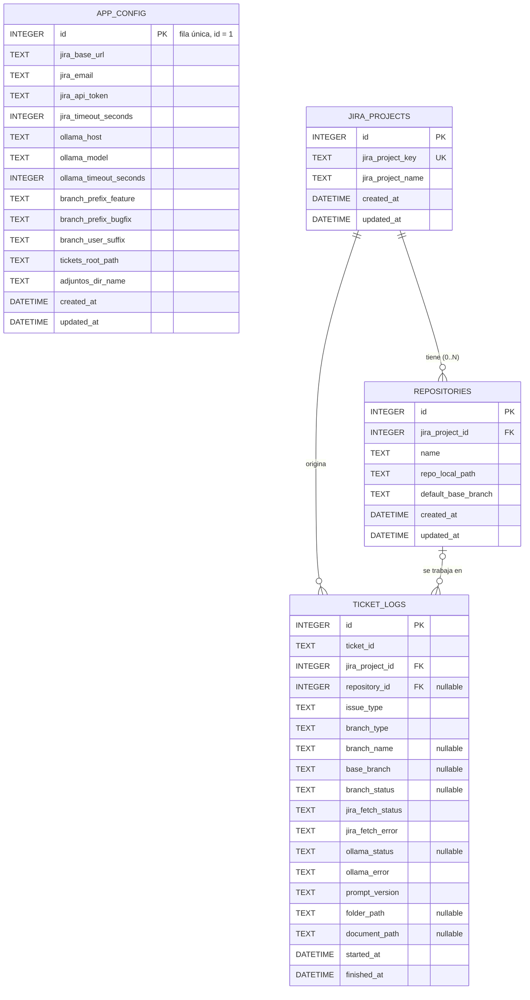

## 3. Modelo de Datos

> Persistencia decidida en [ADR-002.1](ADR-001-arquitectura-inicial.md#adr-0021-persistencia-en-sqlite-embebida-frente-a-archivos-planos-jsonyaml) (SQLite embebida). Consumida por el **SQLite Storage Manager** de la Storage Layer (ver `002-arquitectura-del-sistema.md`, §2.2).

### **3.1. Diagrama del modelo de datos:**



`APP_CONFIG` es una tabla de configuración global de fila única (singleton), sin relación con las demás entidades — por eso aparece sin línea de cardinalidad en el diagrama.

### **3.2. Descripción de entidades principales:**

**`app_config`** — configuración global de la aplicación, fila única (`id = 1`):

| Atributo | Tipo | Restricciones | Descripción |
|---|---|---|---|
| `id` | INTEGER | PK, `CHECK (id = 1)` | Fuerza fila única (patrón singleton). |
| `jira_base_url` | TEXT | NOT NULL | URL base de la instancia de Jira Cloud del equipo (`https://<sitio>.atlassian.net`). |
| `jira_email` | TEXT | NOT NULL | Email de la cuenta Atlassian; junto con el token forma la autenticación Basic de la API REST v2. |
| `jira_api_token` | TEXT | NOT NULL | API Token de Jira ([ADR-001.1](ADR-001-arquitectura-inicial.md#adr-0011-interfaz-clitui-frente-a-aplicación-gráfica-guiweb)). Se guarda **en claro** en el MVP (decisión del 2026-11-01), protegido solo por los permisos del perfil de Windows sobre `%APPDATA%\DevFlowCLI\`; el cifrado (p. ej. DPAPI) queda para v2 (ver `002-arquitectura-del-sistema.md`, §2.5). |
| `jira_timeout_seconds` | INTEGER | NOT NULL, default `10` | Timeout por intento de consulta a Jira; agotado (tras el reintento único) dispara `FallbackManual` (ver `002-arquitectura-del-sistema.md`, §2.2 — Jira REST Client). |
| `ollama_host` | TEXT | NOT NULL, default `http://localhost:11434` | Endpoint HTTP local del servicio Ollama. |
| `ollama_model` | TEXT | NOT NULL, default `qwen2.5:3b` | Nombre del modelo local a invocar. `qwen2.5:3b` es el mínimo viable; el `1.5b` queda descartado por calidad ([ADR-003.1](ADR-001-arquitectura-inicial.md#adr-0031-llm-local-ollama-con-fallback-determinista-frente-a-apis-cloud-openaianthropic)). |
| `ollama_timeout_seconds` | INTEGER | NOT NULL, default `120` | Timeout tras el cual se activa el `FallbackDeterminista` ([ADR-003.1](ADR-001-arquitectura-inicial.md#adr-0031-llm-local-ollama-con-fallback-determinista-frente-a-apis-cloud-openaianthropic)). Medido: 30–105 s por ticket solo con CPU. |
| `branch_prefix_feature` | TEXT | NOT NULL, default `features` | Prefijo de rama para historias, tareas y subtareas. |
| `branch_prefix_bugfix` | TEXT | NOT NULL, default `bugs` | Prefijo de rama para bugs. |
| `branch_user_suffix` | TEXT | NOT NULL | Sufijo de usuario de las ramas (`AROCHA`); formato `^[A-Z0-9]+$` validado por la aplicación. Se configura una vez y se sugiere desde el `displayName` de `/myself`. |
| `tickets_root_path` | TEXT | NOT NULL | Carpeta raíz, fuera de los repositorios Git, bajo la que se crean las carpetas de tickets ([ADR-004.1](ADR-001-arquitectura-inicial.md#adr-0041-almacenamiento-local-de-evidencias-en-carpeta-del-ticket-frente-a-sincronización-automática-con-google-drive)). La aplicación propone `%USERPROFILE%\DevFlowCLI\tickets` al configurar. |
| `adjuntos_dir_name` | TEXT | NOT NULL, default `adjuntos` | Nombre de la subcarpeta de evidencias por ticket y repositorio. |
| `created_at` / `updated_at` | DATETIME | NOT NULL, default `CURRENT_TIMESTAMP` | Auditoría de creación/modificación. |

**`jira_projects`** — claves de proyecto de Jira dadas de alta por el usuario:

| Atributo | Tipo | Restricciones | Descripción |
|---|---|---|---|
| `id` | INTEGER | PK, AUTOINCREMENT | Identificador interno. |
| `jira_project_key` | TEXT | NOT NULL, UNIQUE | Clave de proyecto en Jira (p. ej. `SCRUM`); normalizada a mayúsculas, formato `^[A-Z][A-Z0-9_]+$`. |
| `jira_project_name` | TEXT | NOT NULL | Nombre del proyecto, obtenido de `GET /rest/api/2/project/{key}` al darlo de alta (validación contra Jira). |
| `created_at` / `updated_at` | DATETIME | NOT NULL, default `CURRENT_TIMESTAMP` | Auditoría de creación/modificación. |

**`repositories`** — repositorios locales asociados a una clave (0..N por clave):

| Atributo | Tipo | Restricciones | Descripción |
|---|---|---|---|
| `id` | INTEGER | PK, AUTOINCREMENT | Identificador interno. |
| `jira_project_id` | INTEGER | NOT NULL, FK → `jira_projects(id)` `ON DELETE CASCADE` | Clave de proyecto a la que pertenece. |
| `name` | TEXT | NOT NULL | Nombre del repositorio dentro de la clave (`backend`, `frontend`…); también nombra su subcarpeta de ticket. |
| `repo_local_path` | TEXT | NOT NULL | Ruta absoluta del repositorio local. Se valida al configurar: repositorio Git con remoto `origin`. |
| `default_base_branch` | TEXT | NOT NULL, default `main` | Rama base desde la que nacen las ramas de ticket; la elige el usuario y debe existir en el remoto. Override puntual con `--base`. |
| `created_at` / `updated_at` | DATETIME | NOT NULL, default `CURRENT_TIMESTAMP` | Auditoría de creación/modificación. |

Restricción adicional: `UNIQUE (jira_project_id, name)`.

**`ticket_logs`** — historial de tickets procesados, **una fila por ticket y repositorio** (con *upsert* al reejecutar); fuente de la métrica "tasa de éxito sin fallback" del PRD:

| Atributo | Tipo | Restricciones | Descripción |
|---|---|---|---|
| `id` | INTEGER | PK, AUTOINCREMENT | Identificador interno. |
| `ticket_id` | TEXT | NOT NULL | ID del ticket en Jira (p. ej. `SCRUM-2`). |
| `jira_project_id` | INTEGER | NOT NULL, FK → `jira_projects(id)` | Clave de proyecto a la que pertenece el ticket. |
| `repository_id` | INTEGER | NULL, FK → `repositories(id)` | Repositorio sobre el que se ejecutó; `NULL` si la clave no tiene repositorios (solo documento). |
| `issue_type` | TEXT | NOT NULL | Tipo de issue de Jira tal cual (`Error`, `Historia`…). |
| `branch_type` | TEXT | NOT NULL, `CHECK IN ('feature','bugfix')` | Tipo de rama que corresponde al tipo de issue. |
| `branch_name` | TEXT | NULL | Nombre completo de la rama (`bugs/SCRUM-2-AROCHA`); `NULL` sin repositorio. |
| `base_branch` | TEXT | NULL | Rama base usada en esta ejecución (`main`, `develop`…), incluido el override `--base`. |
| `branch_status` | TEXT | NULL, `CHECK IN ('created','already_existed','pending_changes','error')` | Resultado del Git Manager ([ADR-007.1](ADR-001-arquitectura-inicial.md#adr-0071-ampliación-del-alcance-del-git-manager--verificación-del-working-directory-y-rama-creada-desde-la-base-actualizada)); `NULL` sin repositorio. |
| `jira_fetch_status` | TEXT | NOT NULL, `CHECK IN ('ok','fallback_manual')` | Resultado de la consulta a Jira ([ADR-001.1](ADR-001-arquitectura-inicial.md#adr-0011-interfaz-clitui-frente-a-aplicación-gráfica-guiweb)). |
| `jira_fetch_error` | TEXT | NULL | Motivo del fallo (red / token / 404), si aplica. |
| `ollama_status` | TEXT | NULL, `CHECK IN ('ok','fallback_deterministic','reused')` | Resultado del procesamiento con Ollama ([ADR-003.1](ADR-001-arquitectura-inicial.md#adr-0031-llm-local-ollama-con-fallback-determinista-frente-a-apis-cloud-openaianthropic)); `reused` indica que se copió la Fase 1 generada para otro repositorio del mismo ticket; `NULL` si la ejecución se cortó en Git antes de llegar a Ollama. |
| `ollama_error` | TEXT | NULL | Motivo del fallo (no disponible / timeout / sin modelo), si aplica. |
| `prompt_version` | TEXT | NULL | Versión del prompt y schema usados (`bug-v3`, `historia-v2`); permite medir la tasa de éxito sin fallback por versión. |
| `folder_path` | TEXT | NULL | Ruta de la carpeta del ticket (y repositorio) generada; `NULL` si la ejecución se cortó en Git antes de crearla. |
| `document_path` | TEXT | NULL | Ruta del documento Markdown generado; `NULL` si la ejecución se cortó en Git antes de crearlo. |
| `started_at` | DATETIME | NOT NULL | Inicio de la ejecución (para la métrica de tiempo de arranque del PRD). |
| `finished_at` | DATETIME | NULL | Fin de la ejecución. |

Restricción adicional: `UNIQUE (ticket_id, repository_id)` — una fila por ticket y repositorio. En SQLite, `UNIQUE` no impide duplicados cuando `repository_id` es `NULL`; el *upsert* del `SQLite Storage Manager` trata ese caso (clave sin repositorios) aparte. Las referencias de `ticket_logs` a `jira_projects` y a `repositories` no llevan `ON DELETE CASCADE`: un proyecto o un repositorio con historial **no se puede eliminar** (el historial se protege a propósito) y el *SQLite Storage Manager* lanza el error de clave foránea; la capa que llame debe traducirlo a un mensaje claro. Las ejecuciones que se cortan en Git (`pending_changes`, o `error` por pull fallido) sí registran fila, con `folder_path`, `document_path` y `ollama_status` en `NULL`; las épicas no generan documento ni rama y no registran fila.

**DDL (SQLite):**

```sql
PRAGMA foreign_keys = ON;  -- SQLite no aplica FKs sin este pragma (por conexión)

-- Configuración global de la aplicación (fila única, id = 1)
CREATE TABLE app_config (
    id                      INTEGER PRIMARY KEY CHECK (id = 1),
    jira_base_url           TEXT    NOT NULL,
    jira_email              TEXT    NOT NULL,
    jira_api_token          TEXT    NOT NULL,
    jira_timeout_seconds    INTEGER NOT NULL DEFAULT 10,
    ollama_host             TEXT    NOT NULL DEFAULT 'http://localhost:11434',
    ollama_model            TEXT    NOT NULL DEFAULT 'qwen2.5:3b',
    ollama_timeout_seconds  INTEGER NOT NULL DEFAULT 120,
    branch_prefix_feature   TEXT    NOT NULL DEFAULT 'features',
    branch_prefix_bugfix    TEXT    NOT NULL DEFAULT 'bugs',
    branch_user_suffix      TEXT    NOT NULL,
    tickets_root_path       TEXT    NOT NULL,
    adjuntos_dir_name       TEXT    NOT NULL DEFAULT 'adjuntos',
    created_at              DATETIME NOT NULL DEFAULT CURRENT_TIMESTAMP,
    updated_at              DATETIME NOT NULL DEFAULT CURRENT_TIMESTAMP
);

-- Claves de proyecto de Jira dadas de alta por el usuario
CREATE TABLE jira_projects (
    id                  INTEGER PRIMARY KEY AUTOINCREMENT,
    jira_project_key    TEXT    NOT NULL UNIQUE,      -- 'SCRUM'
    jira_project_name   TEXT    NOT NULL,             -- 'Mi Team' (validado contra Jira en el alta)
    created_at          DATETIME NOT NULL DEFAULT CURRENT_TIMESTAMP,
    updated_at          DATETIME NOT NULL DEFAULT CURRENT_TIMESTAMP
);

-- Repositorios locales asociados a una clave (0..N por clave)
CREATE TABLE repositories (
    id                  INTEGER PRIMARY KEY AUTOINCREMENT,
    jira_project_id     INTEGER NOT NULL REFERENCES jira_projects(id) ON DELETE CASCADE,
    name                TEXT    NOT NULL,             -- 'backend', 'frontend'
    repo_local_path     TEXT    NOT NULL,
    default_base_branch TEXT    NOT NULL DEFAULT 'main', -- rama desde la que nacen las nuevas; la elige el usuario
    created_at          DATETIME NOT NULL DEFAULT CURRENT_TIMESTAMP,
    updated_at          DATETIME NOT NULL DEFAULT CURRENT_TIMESTAMP,
    UNIQUE (jira_project_id, name)
);

-- Una fila por ticket y repositorio (cada ejecución trabaja sobre un repositorio)
CREATE TABLE ticket_logs (
    id                  INTEGER PRIMARY KEY AUTOINCREMENT,
    ticket_id           TEXT    NOT NULL,             -- 'SCRUM-2'
    jira_project_id     INTEGER NOT NULL REFERENCES jira_projects(id),
    repository_id       INTEGER REFERENCES repositories(id),  -- NULL si la clave no tiene repos
    issue_type          TEXT    NOT NULL,             -- tipo de Jira tal cual ('Error', 'Historia'…)
    branch_type         TEXT    NOT NULL CHECK (branch_type IN ('feature', 'bugfix')),
    branch_name         TEXT,                         -- 'bugs/SCRUM-2-AROCHA'; NULL sin repositorio
    base_branch         TEXT,                         -- rama base usada en esta ejecución ('main', 'develop'…)
    branch_status       TEXT    CHECK (branch_status IN ('created', 'already_existed', 'pending_changes', 'error')),
    jira_fetch_status   TEXT    NOT NULL CHECK (jira_fetch_status IN ('ok', 'fallback_manual')),
    jira_fetch_error    TEXT,
    ollama_status       TEXT    CHECK (ollama_status IN ('ok', 'fallback_deterministic', 'reused')),  -- NULL si se cortó en Git
    ollama_error        TEXT,
    prompt_version      TEXT,                         -- 'bug-v3'
    folder_path         TEXT,                         -- NULL si se cortó en Git
    document_path       TEXT,                         -- NULL si se cortó en Git
    started_at          DATETIME NOT NULL,
    finished_at         DATETIME,

    UNIQUE (ticket_id, repository_id)                 -- upsert al reejecutar
);

CREATE INDEX idx_ticket_logs_project ON ticket_logs(jira_project_id);
CREATE INDEX idx_ticket_logs_repository ON ticket_logs(repository_id);
CREATE INDEX idx_ticket_logs_ticket_id ON ticket_logs(ticket_id);
```
